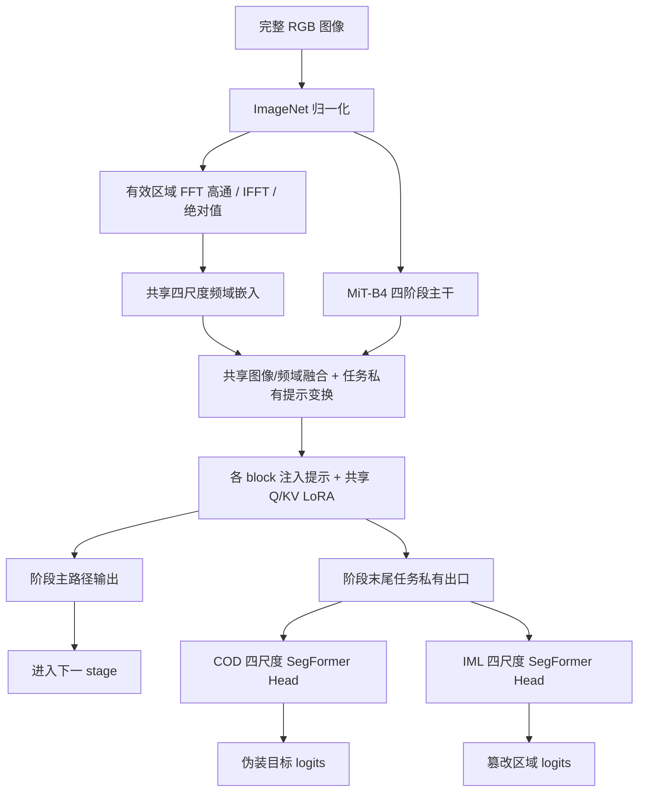

# JointLearning

**Frequency-guided joint learning for camouflaged object detection (COD) and image manipulation localization (IML).**

当前方法以 EVP / MiT-B4 为基础，结合 **共享 Q/KV LoRA、任务私有四尺度出口、任务独立 Adam 统计**。两个任务地位对等，分别使用自己的数据和像素标注，通过共享参数联合学习。

本仓库整理的是 2026-11-06 的改进 QKV 版本。核心模型和训练源码逐文件对齐已冻结的服务器版本；完整性记录见 [source manifest](docs/release_source_manifest.json)。数据集、预训练权重、训练检查点不随源码分发。

## 模型



图中显示两种任务路由；一次指定任务的前向只使用对应私有出口和 decoder。

- **主干**：ImageNet 预训练 MiT-B4，原有通用参数冻结。四阶段通道为 64/128/320/512，深度为 3/8/27/3。
- **频域提示**：保留 EVP 的整图 FFT 高通及逆变换路径，四尺度频域嵌入与图像降维嵌入相加；任务私有 MLP 生成各 block 提示。
- **共享注意力更新**：全部 41 个 block 的 Q 和融合 KV 投影加入 rank-8、alpha-8 LoRA，由两任务共同学习。
- **私有尺度出口**：每个 stage 最后一个 block 的 attention output projection、FFN FC1/FC2 加入任务私有 rank-4、alpha-4 修正。出口只供对应 decoder，主路径输出继续进入下一阶段。
- **解码器**：两套参数独立的 SegFormer Head，投影宽度 768，各输出一张像素 logits 图。
- **联合优化**：共享参数分别维护 COD/IML 的 Adam 一、二阶矩，对自适应更新提议求和；私有参数使用普通 AdamW。

可训练参数共 **7,640,434**，其中共享参数 **772,400**。共享参数不等于任务无关的激活：任务提示会影响各自的主路径特征。

完整公式、出口路由、初始化和方法来源见 [方法设计](docs/METHOD.md)。

## 安装

Python >= 3.10。先按硬件安装匹配的 PyTorch，再安装本项目：

```bash
git clone https://github.com/Pocon041/JointLearning.git
cd JointLearning
python -m pip install -e ".[eval,test]"
python -m pytest -q
```

原 GPU 实验环境是 Python 3.12、PyTorch 2.8.0+cu128、RTX 4090 D，训练及评估使用 BF16。CPU 回归测试使用小模型和合成样本，不等同于 GPU 精度实验。

## 数据与通用预训练权重

准备通用 ImageNet `mit_b4.pth`，参照 [EVP 官方仓库](https://github.com/NiFangBaAGe/Explicit-Visual-Prompt/tree/latest_branch) 的权重说明。当前实验使用文件的 SHA256 为：

```text
bd8e38b6ac5e0415872d006a59a52ece68e7e3b7b9f5902defde56f1c6979999
```

请使用通用分类预训练权重；任务训练权重通过单独的稀疏 checkpoint 恢复。

数据通过 JSONL manifest 读取，每行包含 `image`、`mask`、`task`、`id` 等字段。路径和划分要求见 [数据协议](docs/DATA.md)。本仓库未附原实验逐样本划分名单；只使用相同样本数或自行重新划分，不构成原实验划分的精确复现。

```text
data/manifests/
  cod/  train_quick.jsonl  train_expanded.jsonl  train_full.jsonl  val.jsonl  test.jsonl
  iml/  train_quick.jsonl  train_full.jsonl  val.jsonl  test.jsonl
weights/mit_b4.pth
```

COD 使用 COD10K 的伪装图像；IML 使用 CASIA v2 篡改图及对应二值 mask，当前训练不加入真实图。IML 扩大阶段已使用完整训练池，因此无需单独的 `iml/train_expanded.jsonl`。

## 训练与恢复

从仓库根目录生成三组匹配配置。以下命令只写配置，不启动训练：

```bash
python -m tools.prepare_configs --stage full --pretrained weights/mit_b4.pth --manifest-root data/manifests --output configs/local_full
```

生成的 `both_cod_only`、`both_iml_only`、`both_joint` 使用相同模型和训练预算。单任务组只接受本任务监督；联合组每次更新使用两个任务各一批数据。两任务训练 manifest 都需存在，用于确定一致的预算。

在 BF16 CUDA 环境中，可先运行一次性工程预检：

```bash
python -m cod_iml_evp_joint_v3.audit --config configs/local_full/both_joint.json --output outputs/preflight
```

三组训练命令如下；按显存容量顺序运行或自行调度：

```bash
python -m cod_iml_evp_joint_v3.train --config configs/local_full/both_cod_only.json
python -m cod_iml_evp_joint_v3.train --config configs/local_full/both_iml_only.json
python -m cod_iml_evp_joint_v3.train --config configs/local_full/both_joint.json
```

Quick 和扩大阶段分别使用 `--stage quick`、`--stage expanded` 生成新目录。默认完整协议为 30 轮、1153 次更新/轮、每任务 batch 4；所有阶段均从通用预训练重新初始化。详见 [训练协议](docs/PROTOCOL.md)。

精确恢复只支持完整 epoch 边界，使用原配置和该运行目录的 `last.pt`：

```bash
python -m cod_iml_evp_joint_v3.train --config configs/local_full/both_joint.json --resume runs/full/both_joint/last.pt
```

每轮保留 `epoch_XXX.pt`、`last.pt` 和各任务验证主指标最佳权重。全量训练完成后，才评估最后轮及对应任务最佳验证轮的保留测试集。

## 单图预测

```bash
python -m tools.predict --checkpoint runs/full/both_joint/best_cod.pt --pretrained weights/mit_b4.pth --image example.png --task cod --output outputs/cod_probability.png --device cuda --amp
```

IML 使用 `--task iml` 和对应 checkpoint。输出为原图尺寸的 8-bit 概率 PNG，不进行逐图 min-max。推理沿用 checkpoint 中的全图缩放、padding 和还原方式。

也可以直接构建模型：

```python
from jointlearning import build_model

model = build_model()
model.load_spatial_pretrained("weights/mit_b4.pth")
# 图像为 [B,3,H,W] 的 [0,1] RGB；输出为 raw logits。
cod_logits = model(rgb, task="cod")["cod"]
```

带 batch padding 时，传入每张图的 `processed_sizes`，使 FFT 只处理有效区域；可使用 `pad_collate`。

## 已完成的验证结果

已完成的 **扩大阶段**（6 轮、1153 更新/轮，seed 42）相同结构单任务 → 联合结果：

- COD S：0.862833 → 0.862569；wF：0.763580 → 0.763745；MAE：0.026990 → 0.026807。
- IML F1@0.5：0.393293 → 0.423777；像素宏平均 histogram AUROC：0.891422 → 0.896883。
- IML recall：0.351484 → 0.393772；FPR：0.004825 → 0.008443。

该阶段表现为 **IML 获益，COD 基本保持**，同时存在 IML 误报增加的权衡。上述值来自第 6 轮验证，不是全量阶段结果，也不是独立测试成绩。完整同轮轨迹和最佳验证轮说明见 [结果记录](docs/RESULTS.md) 与 [原始精度轨迹](docs/expanded_validation_history.json)。

## 代码导航与来源

- `cod_iml_evp_joint_v3/`：当前模型、私有出口、任务优化器、训练器和 CUDA 预检。
- `cod_iml_evp_reference/model.py`：EVP 提示共享与共享 Q/KV 注入的父实现。
- `cod_iml_evp_full_image/`：全图几何、FFT 前 padding 处理、数据批处理、损失和低秩线性层。
- `cod_iml_evp_training_v2/strategy.py`：参数分组与 warmup/cosine。
- `cod_iml_evp_official_aligned/`：EVP/MiT 基础算子及 SegFormer decoder。
- `cod_iml_joint/`：保留的数据、指标及兼容依赖。
- `tools/`：配置生成、预测及 CASIA 指标辅助。

为保持冻结源码与回归测试一致，保留了少量父实现和兼容依赖；它们的存在不表示当前配置启用了旧的 DCT 主干或关系桥接模块。当前入口是 `cod_iml_evp_joint_v3.train`。

方法借鉴 [EVP](https://github.com/NiFangBaAGe/Explicit-Visual-Prompt)、[AdaTask](https://github.com/EnnengYang/AdaTask) 和 [MTLoRA](https://github.com/scale-lab/MTLoRA)。我们迁移的是相应提示、任务统计和共享/私有路由原则，未宣称完整复现后三者的原论文实验。

第三方代码的许可证与修改说明见 [THIRD_PARTY_NOTICES.md](THIRD_PARTY_NOTICES.md) 和 [LICENSE](LICENSE)。
